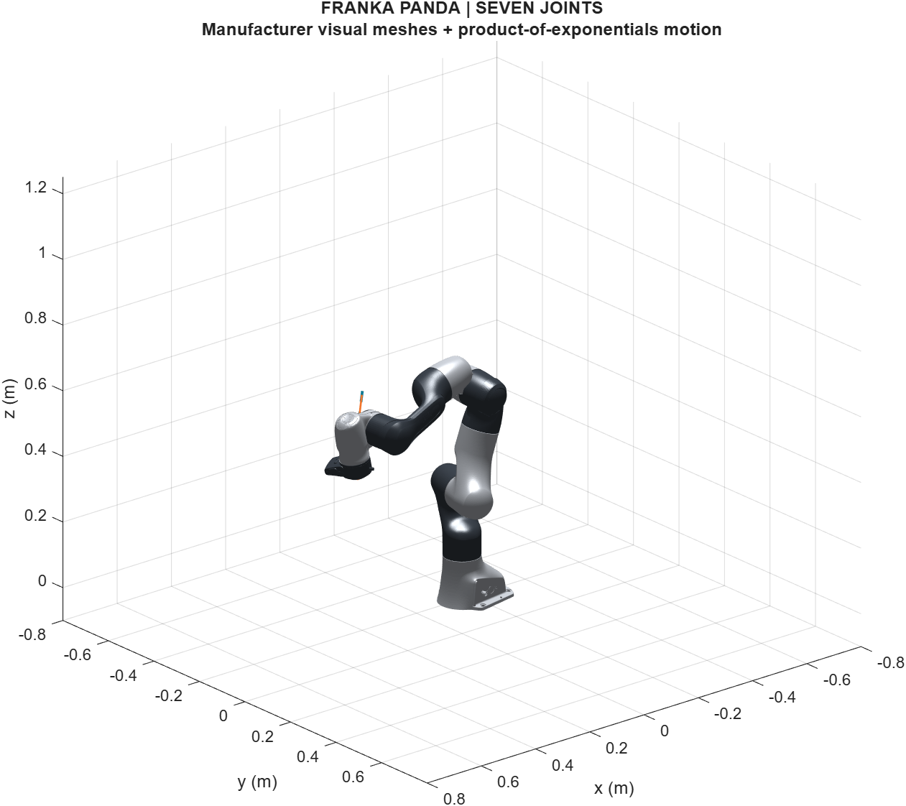

# Franka Panda Geometric Simulator

A standalone MATLAB mechanical simulator of the **seven-joint Franka Emika Panda**. Kinematics use twists, adjoints and exponential maps on SE(3). Spatial Newton-Euler dynamics reuse the optimized kernels developed for SHAPE, with physically feasible identified parameters from Gaz et al. (2019).

Version **0.1.0**. Offline MATLAB runtime, official visual geometry, source provenance and numerical validation included.



## Run

Open the repository in MATLAB:

```matlab
setup_panda;
summary = run_panda_demo();
```

The demo validates the model, tracks a smooth joint reference, checks mechanical energy balance, and repeats integration with half the plant step. It writes `results/demo.mat`, readable JSON metrics and PNG figures. **Base MATLAB only**: no Simulink, Robotics System Toolbox, MEX, Python or network needed at runtime. Tested on R2026a; the plotting and JSON APIs require R2021a or later, but older versions have not been tested.

For playback:

```matlab
addpath('examples');
s = load('results/demo.mat');
animate_panda(s.log,s.m);
```

## Use the model

```matlab
m = panda.model();
q = [0;-.5;0;-1.8;0;1.4;.6];
dq = zeros(7,1);

T = panda.fk(q,m);                         % base-to-flange pose
J = panda.jacobian(q,m,'body');             % 6-by-7, [angular; linear]
[M,b] = panda.dynamics(q,dq,m);             % M*qdd + b = tau
tau = panda.inverse_dynamics(q,dq,zeros(7,1),m);
qdd = panda.forward_dynamics(q,dq,tau,m);
[H,K,V] = panda.energy(q,dq,m);
```

Joint vectors have seven entries; wrenches always have six `[moment; force]` entries. The flange is `panda_link8`, 0.107 m from the final joint frame. Forward dynamics accepts a wrench **applied by the environment**, expressed in that flange frame. Inverse dynamics uses the Modern Robotics convention: the wrench **applied by the flange to the environment**. Their signs are opposite.

```matlab
Fenv = [0;0;0;0;0;1];
tau = panda.inverse_dynamics(q,dq,zeros(7,1),m,-Fenv);
qdd = panda.forward_dynamics(q,dq,tau,m,Fenv);
```

Simulation settings and callbacks are separate from robot parameters:

```matlab
c = panda.config();
c.qgoal = q + [.1;0;.1;-.1;0;.1;0];
c.effectiveness_function = @(t)[1;1-.1*(t>=1);1;1;1;1;1];
c.external_wrench_function = @(t,q,dq)[0;0;0;0;0;.2];
log = panda.simulate(m,c);
```

Default friction is the published sigmoid, including the joint-2 erratum. `panda.model(struct('friction_profile','none'))` disables it. No extra actuator inertia is added by default. An optional nonnegative `additional_apparent_inertia` seven-vector adds a user-specified constant diagonal term once; it is not an identified Panda parameter.

## Model and evidence

The default model uses the **physical parameter set in Tables VIII/IX** of the revised Gaz supplement. Those parameters and the raw identified coefficients used in the authors' generated dynamics are different numerical sets; the supplement explains this distinction. We implement the physical set consistently rather than mixing their mass and bias calculations. See [model conventions](docs/MODEL.md) and the [source review](docs/SOURCE_REVIEW.md).

The current scope is the published seven-link rigid model through the flange. No separate hand or payload is added. Elastic joints, electrical dynamics, contact and collision response are outside this release. Joint limits are monitored, not enforced as physical stops. The demo uses computed torque and a quintic joint reference; it does not run an MPC solver.

Torque inputs here are total link-side generalized efforts. They are **not directly interchangeable with FCI commands**, which use a gravity/friction-compensated interface. This is a research simulation, not a hardware driver.

## Validation and performance

```matlab
setup_panda;
addpath('tests','tools');
validate_panda;
test_source_geometry;
test_simulation_inputs;
benchmark_panda;
```

Checks include an independent COM-Jacobian/Lagrange calculation, mass positivity, gravity/potential consistency, Coriolis/power identities, finite-difference Jacobians, wrench signs, input callbacks, and cache invalidation. In the recorded 40-state run, relative mass disagreement was below `6e-16`. The demo's maximum energy balance error was `5.63e-7 J`; halving the plant step changed joint positions by less than `1.46e-7 rad`.

The recorded warmed serial benchmark of complete `M(q)` and `c+g+f`, using changing states inside the joint limits, measured approximately **6.96x** speedup over the bundled reference implementation: 1,255 microseconds versus 180 microseconds per evaluation. This is a machine-specific measurement, not a timing guarantee. [Validation details and limitations](docs/VALIDATION.md); exact receipts are in `results/`.

## Sources and license

Primary parameter source: C. Gaz, M. Cognetti, A. Oliva, P. Robuffo Giordano and A. De Luca, “Dynamic Identification of the Franka Emika Panda Robot With Retrieval of Feasible Parameters Using Penalty-Based Optimization,” IEEE RA-L, 4(4), 4147–4154, 2019, [DOI](https://doi.org/10.1109/LRA.2019.2931248). [Supplement and erratum](https://diag.uniroma1.it/gaz/panda2019.html).

New code and author-owned reused kernels: **MIT**, Johnny Garcia. Modern Robotics retains its MIT license; manufacturer configuration and geometry retain Apache-2.0. [Third-party notices](THIRD_PARTY_NOTICES.md) explain attribution. Gaz's GPL generated programs are not bundled or called by this simulator. Papers are linked rather than redistributed.

SHA-256 source records are in `sources/manifest.json` and `sources/mesh_manifest.json`. Development-only verification uses Python's standard library:

```text
python tools/verify_sources.py
```

See [CITATION.cff](CITATION.cff) to cite the software and [CHANGELOG.md](CHANGELOG.md) for release history.
