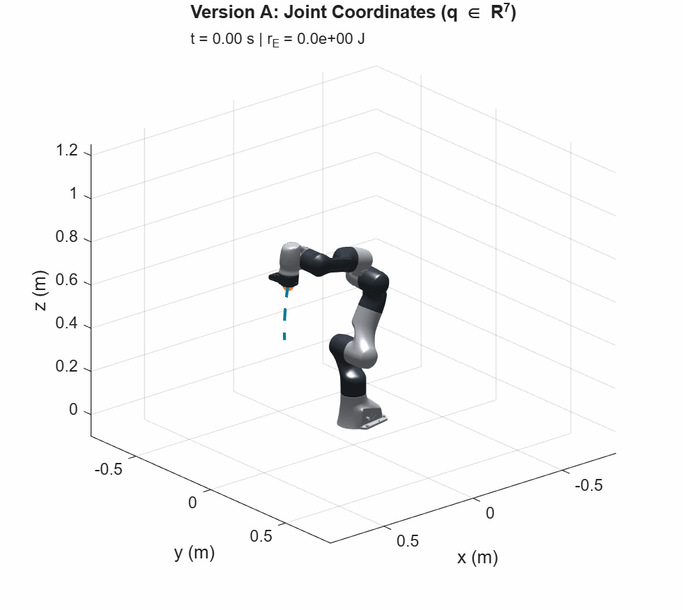
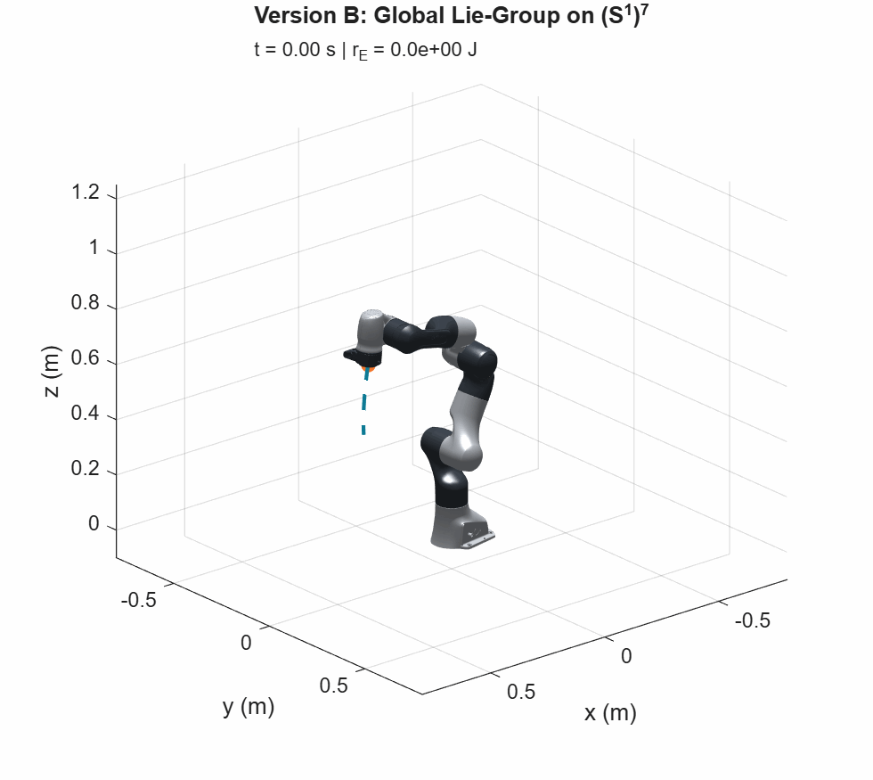
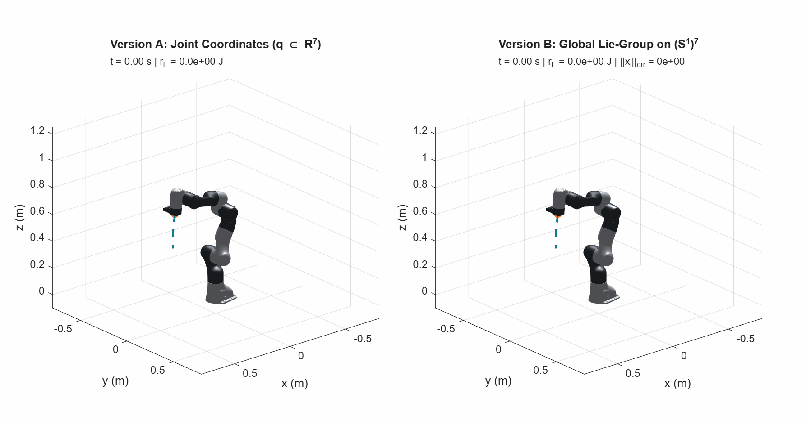
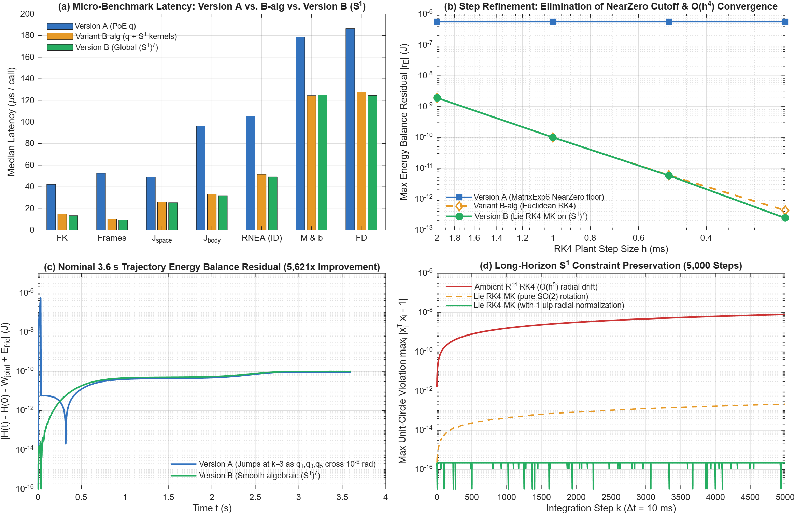

# Franka Panda — Two Geometric Dynamics Formulations

A standalone, reproducible MATLAB mechanical simulator of the **seven-degree-of-freedom Franka Emika Panda**, implementing and comparing two distinct geometric dynamics representations of the same physical robot:
- **Version A — Original Euclidean Dynamics:** Joint coordinates $q \in \mathbb{R}^7$, spatial Product of Exponentials (PoE), and SHAPE-optimized recursive Newton–Euler algorithms (RNEA).
- **Version B — Global Lie-Group Dynamics on $(S^1)^7$:** Configuration on the unit-torus manifold $X \in (S^1)^7$, purely algebraic screw exponentials (Theorem 3.1), hoisted adjoint homomorphism recursion, and Abelian Munthe–Kaas 4-stage Lie-group RK4 integration.

Both formulations share identical identified physical parameters from Gaz et al. (2019), identical actuator effort bounds, and identical friction models. Neither representation modifies the physics of the manipulator.

---

## 3D Visual Comparison: Both Formulations in Motion

| Version A — Original Joint Coordinates ($q \in \mathbb{R}^7$) | Version B — Global Lie-Group on $(S^1)^7$ |
|:---:|:---:|
|  |  |
| *Spatial PoE $\exp([S_i]q_i)$, $\mathbb{R}^7$ angles, SHAPE RNEA* | *Global embedding $X \in (S^1)^7$, algebraic $\exp([S_i], x_i)$, Lie RK4-MK* |

### Combined Side-by-Side Simulation


*3.6 s closed-loop quintic trajectory with computed torque control: desired trajectory (dashed teal) and executed end-effector path (orange for Version A, green for Version B). The trajectories coincide to within $8.33 \times 10^{-16}\text{ rad}$ ($< 1\,\text{ulp}$) at the final state.*

---

## Mathematical Formulations

| Mathematical Aspect | Version A (`+panda/`) — Euclidean PoE | Version B (`+panda_s1/`) — Global $(S^1)^7$ Lie-Group |
|:---|:---|:---|
| **Configuration Space** | $q = [q_1, \dots, q_7]^\top \in \mathbb{R}^7$ | $X = [x_1, \dots, x_7] \in (S^1)^7 \subset \mathbb{R}^{2\times 7}$, with $x_i = [c_i, s_i]^\top$ and $x_i^\top x_i = 1$ |
| **Velocity State** | $\dot{q} \in \mathbb{R}^7$ | Left-trivialized angular velocity $\omega \in \mathbb{R}^7$, with $\dot{x}_i = \omega_i J x_i$ ([Eq. 1](#core-geometric-equations-on-s17)) |
| **Tangent Space** | $T \mathbb{R}^7 \cong \mathbb{R}^7 \times \mathbb{R}^7$ | $T(S^1)^7 \cong (S^1)^7 \times \mathbb{R}^7$ (Global left trivialization) |
| **Space Screw Exponential** | $\exp([S_i] q_i) \in SE(3)$ via series / Rodrigues (`MatrixExp6`) | $\exp([S_i], x_i) = I_4 + s_i [S_i] + (1 - c_i) [S_i]^2$ ([Theorem 3.1](#core-geometric-equations-on-s17): purely algebraic) |
| **Link Transformations** | $T_{0,i} = T_{0,i-1} M_i \exp([a_i] q_i)$, with $a_i = [0, 0, 1, 0, 0, 0]^\top$ | $T_{0,i} = T_{0,i-1} M_i T_z(x_i)$, with $T_z(x_i) = \operatorname{diag}(R_z(x_i), 1)$ (zero transcendental calls) |
| **Inter-Link Adjoints (RNEA)** | $\operatorname{Ad}_{T_{i,i-1}} = \operatorname{Ad}(\exp(-[A_i] q_i) M_i^{-1})$ via dense `Adjoint` | $\operatorname{Ad}_{T_{i,i-1}}(x_i) = \operatorname{diag}(R_z(x_i)^\top, R_z(x_i)^\top) B^{(i)}$ ([Eq. 3](#core-geometric-equations-on-s17)) |
| **Algebraic Character** | Involves trigonometric calls (`cos`, `sin`) at every joint | **Polynomial in $(c_i, s_i)$** for FK, Jacobians, and RNEA; **rational in $(c_i, s_i)$** for FD |
| **Equations of Motion** | $M(q)\ddot{q} + c(q, \dot{q}) + g(q) = \tau$ | $M(X)\dot{\omega} + c(X, \omega) + g(X) = \tau$ (Lee et al. 2018, Eq. 4.12) |
| **Numerical Integration** | Classical 4-stage Runge–Kutta (RK4) in $\mathbb{R}^{14}$ | Abelian Munthe–Kaas 4-stage Lie-group RK4 (RK4-MK) with 1-ulp radial normalization |
| **Joint Limit Representation** | Box bounds: $q_{\min,i} \le q_i \le q_{\max,i}$ | Algebraic arc constraint: $x_i^\top x_i = 1$ and $u_i^\top \hat{x}_i \ge \cos h_i$ ([Eq. 4](#core-geometric-equations-on-s17)) |
| **Large-Displacement Error** | $q_{\text{ref},i} - q_i \in \mathbb{R}$ | Homotopy-consistent admissible-arc displacement $\Delta q_{\mathcal{A}} = \text{box\_diff}(X_{\text{ref}}, X, m)$ |

### Core Geometric Equations on $(S^1)^7$

#### 1. Configuration and Left-Trivialized Velocity Kinematics

$$
x_i = \begin{bmatrix} c_i \\ s_i \end{bmatrix} \in S^1 \subset \mathbb{R}^2, \qquad \dot{x}_i = \omega_i J x_i, \qquad J = \begin{bmatrix} 0 & -1 \\ 1 & 0 \end{bmatrix}
$$

#### 2. Purely Algebraic Space Screw Exponential (Theorem 3.1)

For a unit-axis revolute screw $S_i = [\omega_i; v_i]$ with $\|\omega_i\|_2 = 1$ and zero helical pitch ($\omega_i^\top v_i = 0$), the $SE(3)$ exponential depends purely algebraically on $x_i = [c_i, s_i]^\top \in S^1$:

$$
\exp([S_i], x_i) = I_4 + s_i [S_i] + (1 - c_i) [S_i]^2 = \begin{bmatrix} I_3 + s_i [\omega_i]_\times + (1-c_i)[\omega_i]_\times^2 & s_i v_i + (1-c_i)[\omega_i]_\times v_i \\ 0 & 1 \end{bmatrix}
$$

#### 3. Hoisted Adjoint Homomorphism Factorization in Spatial RNEA

Precomputing constant inverse link adjoints $B^{(i)} = \operatorname{Ad}_{M_i^{-1}}$ allows evaluating inter-link adjoints without matrix inversion or dense multiplications:

$$
\operatorname{Ad}_{T_{i,i-1}}(x_i) = \operatorname{diag}\!\left(R_z(x_i)^\top, R_z(x_i)^\top\right) B^{(i)}
$$

#### 4. Algebraic Characterization of the Admissible Joint Arc ($0 < h_i < \pi$)

Because all 7 Panda joints satisfy $0 < h_i = \frac{1}{2}(q_{\max,i} - q_{\min,i}) \le 2.8973 < \pi$, the admissible arc $\mathcal{A}_i \subset S^1$ is exact and unambiguous:

$$
\mathcal{A}_i = \left\{ x_i \in \mathbb{R}^2 \;\middle|\; x_i^\top x_i = 1,\;\; u_i^\top \hat{x}_i \ge \cos h_i \right\}, \qquad u_i = \begin{bmatrix} \cos m_i \\ \sin m_i \end{bmatrix} \in S^1
$$

where $m_i = \frac{1}{2}(q_{\min,i} + q_{\max,i})$ and $\hat{x}_i = x_i / \|x_i\|_2$.

---

## Performance & Accuracy Benchmark

Evaluated on **MATLAB R2026a Update 4** across $N = 100$ independent states ($1,000$ timed evaluations per routine) with CPU warm-up.

All states are sampled strictly inside the **physically admissible operating envelope** of the Franka Emika Panda via bounded uniform position sampling and rejection-truncated normal sampling:
- Position utilization: $\max_{i,k} |q_{i,k} - m_i|/h_i = 0.9686 \le 1.00$ ($0$ violations)
- Velocity utilization: $\max_{i,k} |\dot{q}_{i,k}|/\dot{q}_{\max,i} = 0.9459 \le 0.95$ ($0$ violations)
- Torque utilization: $\max_{i,k} |\tau_{i,k}|/\tau_{\max,i} = 0.9277 \le 0.95$ ($0$ violations)

To separate **algorithmic specialization** (revolute $z$-axis rotations and hoisted adjoints) from the **manifold representation** ($X \in (S^1)^7$ vs. $q \in \mathbb{R}^7$), the benchmark includes **Variant B-alg** ($q \in \mathbb{R}^7 \mapsto [\cos q^\top; \sin q^\top]$ + specialized $S^1$ kernels).

### 1. Micro-Benchmarks: Median Latency per Evaluation ($\mu\text{s}$)

| Operation | Complexity | Stock MR | Version A ($q \in \mathbb{R}^7$) | Variant B-alg ($q + S^1$ kernels) | Version B ($X \in (S^1)^7$) | Speedup B vs. Stock | Speedup B vs. A | Speedup B vs. B-alg |
|:---|:---:|:---:|:---:|:---:|:---:|:---:|:---:|:---:|
| **Forward Kinematics (`fk`)** | $O(n)$ | $42.13\,\mu\text{s}$ | $42.24\,\mu\text{s}$ | $14.92\,\mu\text{s}$ | **$13.29\,\mu\text{s}$** | **$3.17\times$** | **$3.18\times$** | **$1.12\times$** |
| **Link Frames (`frames`)** | $O(n)$ | $49.28\,\mu\text{s}$ | $52.49\,\mu\text{s}$ | $9.96\,\mu\text{s}$ | **$9.08\,\mu\text{s}$** | **$5.43\times$** | **$5.78\times$** | **$1.10\times$** |
| **Space Jacobian ($J_s$)** | $O(n)$ | $48.10\,\mu\text{s}$ | $49.01\,\mu\text{s}$ | $25.90\,\mu\text{s}$ | **$25.24\,\mu\text{s}$** | **$1.91\times$** | **$1.94\times$** | **$1.03\times$** |
| **Body Jacobian ($J_b$)** | $O(n)$ | $48.07\,\mu\text{s}$ | $96.25\,\mu\text{s}$ | $33.11\,\mu\text{s}$ | **$31.73\,\mu\text{s}$** | **$1.52\times$** | **$3.03\times$** | **$1.04\times$** |
| **Inverse Dynamics (`id`, RNEA)** | $O(n)$ | $162.38\,\mu\text{s}$ | $105.27\,\mu\text{s}$ | $51.45\,\mu\text{s}$ | **$49.07\,\mu\text{s}$** | **$3.31\times$** | **$2.15\times$** | **$1.05\times$** |
| **Dynamics (`dyn`, $M$ and $b$)** | $O(n^2) + O(n)$ | $1,271.50\,\mu\text{s}$ | $178.47\,\mu\text{s}$ | **$124.34\,\mu\text{s}$** | $124.99\,\mu\text{s}$ | **$10.17\times$** | **$1.43\times$** | $0.99\times$ |
| **Forward Dynamics (`fd`, $\ddot{q}$)** | $O(n^2) + O(n^3)$ | $1,297.35\,\mu\text{s}$ | $186.53\,\mu\text{s}$ | $127.72\,\mu\text{s}$ | **$124.53\,\mu\text{s}$** | **$10.42\times$** | **$1.50\times$** | **$1.03\times$** |

### 2. Full 3.6 s Closed-Loop Simulation (3,600 RK4 Substeps)

| Simulation Metric | Version A ($q \in \mathbb{R}^7$, PoE) | Variant B-alg ($q + S^1$ Kernels) | Version B ($(S^1)^7$, Lie RK4-MK) |
|:---|:---:|:---:|:---:|
| **Wall-Clock Time** | $3,067.88\text{ ms}$ | **$2,091.79\text{ ms}$** | **$2,158.82\text{ ms}$** |
| **Substep Latency** | $852.19\,\mu\text{s}$ | **$581.05\,\mu\text{s}$** | **$599.67\,\mu\text{s}$** |
| **Real-Time Factor (RTF)** | $1.17\times$ | **$1.72\times$** | **$1.67\times$** |
| **Speedup vs. Version A** | $1.00\times$ | **$1.47\times$** | **$1.42\times$** |
| **Nominal Energy Balance Error** | $5.6218 \times 10^{-7}\text{ J}$ | **$9.9790 \times 10^{-11}\text{ J}$** | **$1.0000 \times 10^{-10}\text{ J}$** |
| **Final Trajectory Parity vs. B** | $8.3267 \times 10^{-16}\text{ rad}$ | **$8.8818 \times 10^{-16}\text{ rad}$** | $0$ (Reference) |
| **Max $S^1$ Unit-Norm Error** | N/A | N/A | **$2.2204 \times 10^{-16}$ ($1\,\text{ulp}$)** |



---

## Scientific Findings

### 1. Elimination of the `NearZero` Discontinuity ($5,621\times$ to $2.3\times 10^6\times$ Energy Conservation)
In Version A, the Modern Robotics kernel `MatrixExp6` calls `NearZero(norm(omgtheta))` with threshold $|q_i| < 10^{-6}\text{ rad}$ to avoid division by zero when recovering $\theta$ from `se3mat`. When joints 1, 3, and 5 accelerate from $q_i(0)=0$, crossing $10^{-6}\text{ rad}$ at step $k=3$ introduces an artificial $O(10^{-6})$ step discontinuity in $R_i \to I_3$. This created a fixed $5.62 \times 10^{-7}\text{ J}$ error floor that could not be reduced by refining the time step.

Because rotations are evaluated algebraically in terms of $x_i = [c_i, s_i]^\top \in S^1$ without angle division, the vector field is $C^\infty$ at $q_i=0$. This smooth formulation is shared by **Variant B-alg** ($9.98 \times 10^{-11}\text{ J}$) and **Version B** ($1.00 \times 10^{-10}\text{ J}$):
- At $h = 1.0\text{ ms}$, the energy balance residual drops to **$1.0000 \times 10^{-10}\text{ J}$ ($5,621\times$ better than Version A)**.
- Under step refinement ($h = 0.5\text{ ms} \implies 5.77 \times 10^{-12}\text{ J}$; $h = 0.25\text{ ms} \implies 2.44 \times 10^{-13}\text{ J}$), the formulation recovers true **$O(h^4)$ 4th-order Runge–Kutta convergence** (a **$2,302,747\times$ advantage** over Version A at $h = 0.25\text{ ms}$).
- **Integrator Nature:** RK4-MK is an explicit 4th-order Lie-group Runge–Kutta integrator on $(S^1)^7 \times \mathbb{R}^7$, not a symplectic variational integrator. It preserves the configuration manifold to $1\,\text{ulp}$ ($2.22 \times 10^{-16}$), and conserves energy numerically to order $O(h^4)$.

### 2. Topological Analysis of Joint Limits ($2h_i > \pi$ Hazard)
All 7 Panda joints have finite limits with span $2h_i < 2\pi$. However, **6 out of 7 joints have span $2h_i > \pi$**.
- When $|\Delta q_i| > \pi$, the shortest geodesic on $S^1$ (`geodesic_diff`) points **across the forbidden mechanical stop** (experimentally verified to cause a $0.2433\text{ rad}$ stop violation on Joint 1).
- Version B solves this via the homotopy-consistent admissible-arc displacement `box_diff(X2, X1, m)`, which lifts $x_i$ into the reference frame of the arc midpoint $u_i = [\cos m_i, \sin m_i]^\top$. This guarantees that the branch cut lies at $m_i \pm \pi \in S^1 \setminus \mathcal{A}_i$, enabling completely smooth traversal of the $+\pi$ boundary on Joint 6 ($[-0.0175, +3.7525]\text{ rad}$) with zero limit violations.
- **Monitoring vs. Dynamic Invariance:** `check_limits.m` validates both $S^1$ manifold membership ($|x_i^\top x_i - 1| \le \text{tol}_{\text{norm}}$) and the normalized arc inequality ($u_i^\top \hat{x}_i \ge \cos h_i$). The simulator monitors stage margins at all RK4 substeps (`minimum_stage_limit_margin_rad`, `maximum_stage_limit_violation_rad`) and saturates command torques at $\pm\tau_{\max}$, without asserting dynamic forward invariance (viability) or contact collision mechanics.

### 3. Decomposition: Algorithmic Specialization vs. Manifold Representation
Comparing Version B with Variant B-alg reveals that **$\sim 88\%\text{--}95\%$ of the execution speedup** over Version A comes from Theorem 3.1 and the hoisted adjoint factorization $B^{(i)} = \operatorname{Ad}_{M_i^{-1}}$ (which also benefits $q \in \mathbb{R}^7$). Storing $X \in (S^1)^7$ directly provides an **additional 3%–12% speedup** in individual kinematics and inverse dynamics calls by eliminating runtime `cos(q)` and `sin(q)` calls, while closed-loop simulation shows a minor 3.2% overhead ($2,091.79\text{ ms}$ vs. $2,158.82\text{ ms}$) due to the 4 Lie-group `exp_s1` stage updates per RK4-MK substep.

---

## Repository Structure & Code Links

```
Franka-Panda-Geometric-Simulator/
├── +panda/                         # Version A: Original Euclidean Dynamics (Unmodified)
│   ├── fk.m                        # Forward kinematics via MatrixExp6 PoE
│   ├── frames.m                    # Link frames via MatrixExp6 chain
│   ├── jacobian.m                  # Space & body twist Jacobians
│   ├── dynamics.m                  # M(q) and b(q, dq) via SHAPE RNEA
│   ├── inverse_dynamics.m          # RNEA with friction and external wrench
│   ├── forward_dynamics.m          # q_ddot = M \ (tau - b)
│   ├── energy.m                    # Mechanical Hamiltonian H = K + V
│   └── simulate.m                  # Classical RK4 simulation in R^14
│
├── +panda_s1/                      # Version B: Global Lie-Group Dynamics on (S^1)^7
│   ├── screw_exp.m                 # Purely algebraic space screw exponential (Theorem 3.1)
│   ├── fk.m                        # Space PoE on (S^1)^7 via screw_exp
│   ├── frames.m                    # Algebraic link frames via direct R_z(x_i)
│   ├── jacobian.m                  # Algebraic space and body Jacobians on (S^1)^7
│   ├── dynamics.m                  # M(X) and b(X, omega) via S1 RNEA
│   ├── inverse_dynamics.m          # S1 RNEA with friction and wrench
│   ├── forward_dynamics.m          # omega_dot = M \ (tau - b)
│   ├── energy.m                    # Mechanical Hamiltonian H(X, omega)
│   ├── reference.m                 # Intrinsic quintic reference interpolation on A
│   ├── check_limits.m              # Algebraic arc & manifold constraint on (S^1)^7
│   ├── box_diff.m                  # Homotopy-consistent admissible-arc displacement
│   ├── geodesic_diff.m             # Intrinsic SO(2) logarithm on S^1
│   ├── exp_s1.m                    # Group action Exp_{S^1}(dtheta, X) with 1-ulp renorm
│   ├── draw_robot.m                # 3D mesh rendering posed by (S^1)^7 frames
│   ├── lagrange_reference.m        # Independent COM-Jacobian Lagrange oracle on (S^1)^7
│   └── simulate.m                  # Munthe-Kaas Lie-group RK4 simulation on (S^1)^7 x R^7
│
├── third_party/shape_kernels/
│   ├── rnea_shared_kinematics_MR.m # Version A SHAPE kinematics kernel
│   └── rnea_shared_kinematics_S1.m # Version B Adjoint-homomorphism S1 kernel
│
├── tests/
│   ├── validate_panda.m            # Version A mechanical validation suite
│   ├── validate_panda_s1.m         # Version B Lie-algebra & Lagrange validation on (S^1)^7
│   ├── test_s1_geometry_limits.m   # Geometry, bounds, and roundtrip tests on (S^1)^7
│   └── test_s1_simulation_consistency.m # RK4-MK, energy, branch cut (+pi), and limits
│
├── tools/
│   ├── benchmark_panda.m           # Version A original baseline benchmark
│   ├── benchmark_s1_comparison.m   # 4-way comparative benchmark (Stock vs A vs B-alg vs B)
│   └── generate_panda_animations.m # Generates 3D animated GIFs for both formulations
│
├── docs/development/               # Milestone audit records and technical handoffs
│   ├── MATHEMATICAL_FORMULATION.md # Milestone 1 mathematical foundation
│   ├── GEOMETRIC_DYNAMICS_IMPLEMENTATION.md # Milestone 3 implementation report
│   ├── INTEGRATION_AND_CONSTRAINTS.md # Milestone 4 integration & constraint guarantees
│   ├── BENCHMARK_COMPARISON.md     # 4-Way benchmark analysis and physical sampling
│   ├── SCIENTIFIC_REVIEW_HITO6.md  # Milestone 6 scientific quality audit
│   ├── POST_RELEASE_REVIEW.md      # Comprehensive review cycles R0–R3
│   └── HANDOFF.md                  # Milestone tracking and AI handoff state
│
├── run_panda_demo.m                # Run Version A demo
└── run_panda_s1_demo.m             # Run Version B demo
```

---

## Quickstart & Reproducibility

Open MATLAB in the repository root directory:

```matlab
setup_panda;

% 1. Run Version A Demo (Original Euclidean Dynamics)
summary_a = run_panda_demo();

% 2. Run Version B Demo (Global (S^1)^7 Lie-Group Dynamics)
summary_b = run_panda_s1_demo();

% 3. Run Comprehensive 4-Way Scientific Benchmark (Physically Admissible Envelope)
report = benchmark_s1_comparison();

% 4. Regenerate 3D Animated GIFs
generate_panda_animations();
```

---

## Real Limitations & Out-of-Scope Topics

To maintain scientific integrity:
1. **Rigid Link-Side Model:** The simulator models the published 7-link rigid dynamics through the flange (`panda_link8`). Elastic joint flexibility, electrical motor dynamics, hand/gripper payloads, and contact collision dynamics are outside the current scope.
2. **Monitoring vs. Stop Physics:** Joint limits are monitored at every integration stage (`minimum_stage_limit_margin_rad`, `maximum_stage_limit_violation_rad`), and command torques are saturated at `m.taumax`. The simulator does not implement an inelastic collision restitution model at the hard stops or an active control-barrier certificate.
3. **Runge–Kutta Energy Conservation:** RK4-MK is an explicit 4th-order Lie-group Runge–Kutta integrator, not a symplectic variational integrator. While its energy balance residual is remarkably small ($1.00 \times 10^{-10}\text{ J}$ at $h = 1\text{ ms}$, $2.44 \times 10^{-13}\text{ J}$ at $h = 0.25\text{ ms}$), energy is conserved numerically to $O(h^4)$, not identically.

---

## Scientific References

1. **Lee, T., Leok, M., & McClamroch, N. H.** (2018). *Global Formulations of Lagrangian and Hamiltonian Dynamics on Manifolds: A Variational Approach*. Springer. [DOI: 10.1007/978-3-319-56953-6](https://doi.org/10.1007/978-3-319-56953-6).
2. **Gaz, C., Cognetti, M., Oliva, A., Robuffo Giordano, P., & De Luca, A.** (2019). "Dynamic Identification of the Franka Emika Panda Robot With Retrieval of Feasible Parameters Using Penalty-Based Optimization." *IEEE Robotics and Automation Letters*, 4(4), 4147–4154. [DOI: 10.1109/LRA.2019.2931248](https://doi.org/10.1109/LRA.2019.2931248).
3. **Lynch, K. M., & Park, F. C.** (2017). *Modern Robotics: Mechanics, Planning, and Control*. Cambridge University Press.
4. **Carpentier, J., et al.** (2019). "The Pinocchio C++ library: A fast and flexible implementation of rigid body dynamics algorithms and their analytical derivatives." *IEEE/SICE SII*. (`JointModelRevoluteUnbounded`).

---

## License & Provenance

- New simulation code, global $(S^1)^7$ formulation, and SHAPE kernels: **MIT License**, Johnny Garcia.
- Modern Robotics library components: **MIT License**, Northwestern University.
- Visual mesh files: **Apache-2.0 License**, Franka Emika GmbH.
- Identified parameters: Gaz et al. (2019) revised supplement.
- SHA-256 source verification: `python tools/verify_sources.py`.
